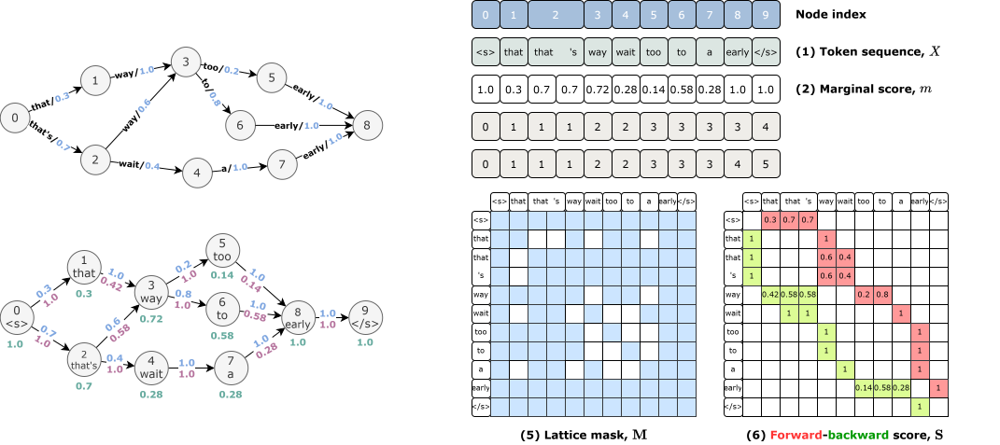

# LatticeBART

<p>
  <a href="https://www.paperdigest.org/paper/?paper_id=icassp-ICASSP43922.2022.9746796-2022-05-22"></a>
  <a href="https://rc.signalprocessingsociety.org/conferences/icassp-2022/spsicassp22vid0071"></a>
  
  
</p>

Official implementation of **"LatticeBART: Lattice-to-Lattice Pre-Training for Speech Recognition"**,
published at ICASSP 2022 (pp. 6112–6116).

ASR systems don't output a single sentence — they output a **word lattice**: a compact graph holding
many competing hypotheses. Standard sequence models can't consume that structure directly, and
N-best rescoring throws most of it away. LatticeBART reads the lattice as a first-class input and
decodes the corrected transcript end-to-end, on top of a pre-trained BART backbone.

## Key ideas

1. **Lattice in, sentence out.** A lattice-aware Transformer encoder consumes the word lattice
   directly; an autoregressive BART decoder generates the final transcript. No N-best bottleneck.
2. **Lattice-aware self-attention.** Attention is constrained by lattice reachability
   (`lattice_mask`), biased by forward-backward scores (`forward_backward`), enriched with
   node marginal probabilities, and positioned by min/max topological depth — so the model
   knows *where* each node sits in the graph, not just what it says.
3. **Lattice-to-lattice pre-training.** When annotated data is scarce, corrupt an input lattice
   (homophone replacement, token masking, depth disturbance) and train the model to reconstruct
   the clean sentence. Training lattices are generated by an off-the-shelf Kaldi ASR system —
   no manual transcripts needed.

<p align="center">
  
  <br />
  <em>How a word lattice is encoded: the ASR lattice with arc posteriors (top-left) is annotated
  with node marginals (bottom-left), linearized into a token sequence with min/max topological
  depth (top-right), and turned into a reachability mask plus forward-backward score matrix
  (bottom-right) that drive the lattice-aware self-attention.</em>
</p>

## Architecture

Built on HuggingFace `transformers` BART (`BartForConditionalGeneration`):

| Module | File | What it does |
|---|---|---|
| `LatticeBart` | `models/lattice_bart.py` | BART seq2seq wiring lattice encoder + decoder |
| `LatticeEncoder` | `models/encoder.py` | `LatticeSelfAttention`: mask + forward-backward + marginals + depth |
| `LatticeDecoder` | `models/decoder.py` | Standard BART decoder, generates the transcript |
| Data pipeline | `dataset/` | Kaldi lattice parsing, graph batching, visualization (`graph_visual.py`) |
| Lattice tools | `tools/` | Pruning, oracle/best-path extraction, Fisher/Switchboard & LibriSpeech prep |

Model configs (`tiny` / `base` / `large`) live in `models/configs/`.

## Data

- **Fisher + Switchboard**: word lattices from a Kaldi nnet3 system (`tools/prepare_data_fisher_swbd.sh`)
- **LibriSpeech**: prep scripts in `tools/prepare_data_librispeech.sh`

## Quick start

```bash
# 1. Pre-train on lattices (SLURM example, 4x GPU)
bash Scripts/pretrain_lat_bart_ark.sh

# 2. Fine-tune for rescoring
python Scripts/train_lattice_bart.py --help

# 3. Rescore with the trained model
bash Scripts/rescore_pipeline.sh
```

See `Scripts/` for the full training/eval pipelines and `tools/` for lattice preparation.
This is research code — expect to adapt paths in the shell scripts to your own Kaldi setup.

## Citation

```bibtex
@inproceedings{dai2022latticebart,
  title={LatticeBART: Lattice-to-Lattice Pre-Training for Speech Recognition},
  author={Dai, Lingfeng and Chen, Lu and Zhou, Zhikai and Yu, Kai},
  booktitle={Proc.\ IEEE Int.\ Conf.\ Acoustics, Speech and Signal Process.\ (ICASSP)},
  pages={6112--6116},
  year={2022},
  address={Singapore}
}
```

## Authors

Lingfeng Dai, Lu Chen, Zhikai Zhou, Kai Yu — Shanghai Jiao Tong University
